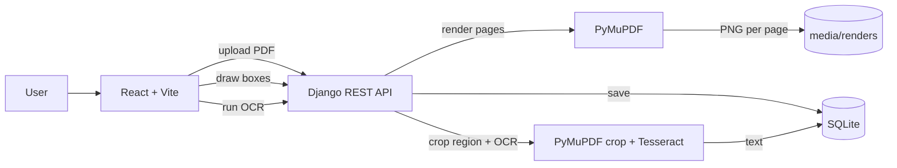

# Construction Drawing Annotator

A small web app for annotating multipage construction drawings. You import a PDF, page through it, draw red boxes around content to ignore and green boxes around text to capture, and the annotations survive a restart. Green boxes can be run through local OCR to pull out their text.

Stack is React for frontend and Django + Django REST Framework (DRF) on the backend, which lines up with the Provision job description (React, Python, Django).

## What it does

All of the firm requirements are working:

- Import and view the attached multi-page PDF.
- Move between pages (Prev / Next, with a page counter).
- Draw red rectangles around content to ignore.
- Draw green rectangles around text to capture.
- Persist annotations. They live in the database, so closing and reopening the app brings them back.

The optional bonus is also working:

- Run OCR locally (Tesseract) on the contents of a green rectangle and save the extracted text. There is a per-box "OCR" button and an "OCR all green" button for the current page.

## OCR usage

Every page in the sample PDF has an empty text layer. The drawings are vector and raster art with no selectable text underneath (at least for this test PDF provided). Utilized `pytesseract` for OCR for text extraction.

## Architecture



## How to run

You need Python 3.10+, Node 18+, and the Tesseract binary.

Install Tesseract:

- macOS: `brew install tesseract`
- Ubuntu or Debian: `sudo apt-get install tesseract-ocr`
- Windows: install from the UB Mannheim build and add it to PATH

### Backend

```
cd backend
python -m venv .venv
source .venv/bin/activate          # Windows: .venv\Scripts\activate
pip install -r requirements.txt
python manage.py migrate
python manage.py runserver          # serves http://localhost:8000
```

### Frontend

```
cd frontend
npm install
npm run dev                         # serves http://localhost:5173
```

## API reference

- `POST /api/documents/` (multipart, field `file`): upload a PDF, render pages, return the document with page image URLs and any annotations.
- `GET /api/documents/` : list documents.
- `GET /api/documents/{id}/` : one document with its pages and annotations.
- `GET /api/annotations/?document={id}&page={n}` : list annotations.
- `POST /api/annotations/` : create a box.
- `DELETE /api/annotations/{id}/` : delete a box.
- `POST /api/annotations/{id}/ocr/` : run OCR on a green box, save and return the text.